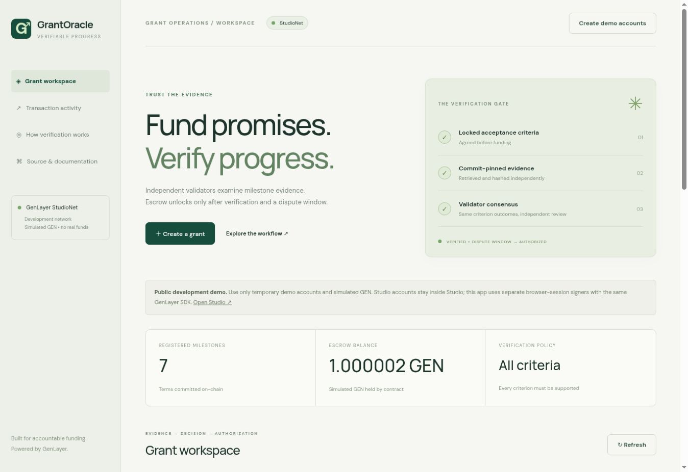

# Verified execution evidence

Network: **StudioNet 61999**. All demonstrations use fictional milestones and simulated GEN. All contract writes in the completed suite use full consensus (`leaderOnly:false`).

## Deployment

- Contract: `0xfC94797c8b1AA6d31023fE0C30ED60320F80Ca64`
- Built-in Studio deployer: `0xf3C059C1495C80c4C94D4eB9eA43FE2fd5D6ED88`
- Finalized deployment: [0x1edc039a…](https://explorer-studio.genlayer.com/transactions/0x1edc039af42866c5f2ee449be43ac3988e2c4625afa8a4c81606484c13845e23)
- `evidence/deployment-receipt.json`: RPC receipt snapshot, with noisy provider configuration removed.
- `evidence/deployed-source.py`: source read back from the deployed address, verified byte-for-byte equal to the contract source.

## Completed live suite

`evidence/live-scenarios.json` records every call's arguments, IDs, outcomes, leader return, validator votes, final receipts, source fingerprints, decisions and final balances. **All 25 parent transactions finalized**. The final duplicate withdrawal intentionally finalized with a rollback; this is the expected protective behavior, not a successful payout.

| Record / action | Verified result | Transaction |
| --- | --- | --- |
| #5 review | PARTIALLY_COMPLETED | [Review](https://explorer-studio.genlayer.com/transactions/0x7bf422b937c5290c083f93704ad892aa4ea6ebb907b2ba1e3e7d51364c0caa2d) |
| #6 review | REJECTED | [Review](https://explorer-studio.genlayer.com/transactions/0xcb9b38a9f9e8eeb79a24d0d9e65bd8449eb6b401cceae7bd69624d210a1c14b3) |
| #7 first review | INCONCLUSIVE, incorrect hash | [Review](https://explorer-studio.genlayer.com/transactions/0x8a8788f026ec0b4dce922175a5e3cfaf450cb562ee84d2af2bfb480e28337e8d) |
| #7 challenge | New correct evidence commitment | [Challenge](https://explorer-studio.genlayer.com/transactions/0x6ed6eb21dac26db86875b1055117cc5d91e50c50d830f355f450a8a442b8e5f3) |
| #7 rebuttal | Opposing party evidence during separate window | [Rebuttal](https://explorer-studio.genlayer.com/transactions/0x9725fa16a571567d3abaa062eeb037fdc7858a7e08bde9ec580b120cb06c7668) |
| #7 second review | VERIFIED | [Review](https://explorer-studio.genlayer.com/transactions/0x9d945659042784bd55d07d894c72c7d6bc456b704c651048e91e781332ab579f) |
| #5 refund child | FINALIZED, 1,000,000,000,000 wei to funder | [Transfer](https://explorer-studio.genlayer.com/transactions/0x9d6521e3be7294324cb1f0e2afcd10578381153b53c0d7ee2b0f95c0fb5c135f) |
| #6 refund child | FINALIZED, 1,000,000,000,000 wei to funder | [Transfer](https://explorer-studio.genlayer.com/transactions/0x90cacca889b73dd4daec38c67b3623f2986de5b0435a0fda5775d839bc6becfd) |
| #7 payout child | FINALIZED, 1,000,000,000,000 wei to recipient | [Transfer](https://explorer-studio.genlayer.com/transactions/0x4a498128019f5c4045981f5cfcf1ce708bfa1f62136850e4ca7c6e5a7854285d) |
| #7 duplicate withdrawal | Rollback: No withdrawal available | [Rejected duplicate](https://explorer-studio.genlayer.com/transactions/0x33725bfc3cdfc90f1f02fd14e48777824d1808a10c4a7098b49bee438cfd57ee) |

Funder `0x374939CD60C0ff2040A805F4bBC633a8C4955Be7` began with a 1 GEN faucet balance, funded three 0.000001 GEN milestones, received two refunds, and ended with **0.999999 GEN**. Recipient `0x684e612FAA9D0C67740e349435722b9be78945d0` began at zero and ended with **0.000001 GEN**. Both final balances were read after transfer finalization. Earlier `balanceBefore`/`balanceAfter` entries in the raw scenario log are acceptance-time snapshots; they are deliberately retained and are not evidence of final delivery.

## Browser and public hosting

The public Site deployment succeeded at https://grantoracle.tinymule33.chatgpt.site/ and was opened in a browser without a sign-in wall. It showed real finalized grant records from the contract. Temporary account creation, the grant form and public transaction submission were exercised. The local browser walkthrough exercised recipient acceptance, file hashing, submission and review against the same deployed contract and production client code. Additional finalized browser receipts are in `evidence/browser-flow.json`. A final additional browser-only settlement run was not completed: automatic approval review rejected creation of another grant as a consequential contract transaction. The fully finalized scripted suite independently proves payout/refund settlement. Milestone #4 remains a provisional VERIFIED browser demonstration, not a claimed completed browser payout.

## Honest development history

An initial fractional-GEN proposal (#1) remains unfunded because Studio's payable input uses integer GEN parsing. A replacement whole-GEN milestone (#4) was created and funded with the actual Studio built-in account. The DApp supports fractional amounts through exact wei conversion.

The first automated run stopped after misclassifying an idle validator appended to `leader_receipt` as the execution leader. Its raw record is preserved in `evidence/initial-run.json`. On-chain submission #3 actually succeeded. Receipt interpretation was fixed to select the actual leader, with a regression test, and the full suite was rerun successfully as #5–#7. Initial test records #2/#3 remain visible. Their process-only test signers were not retained; these are simulated funds and are not presented as completed refunds.

No screenshots or transaction IDs are fabricated. No video, public social announcement, audit, production deployment or real user traction is claimed.
